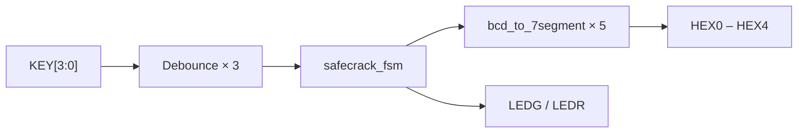
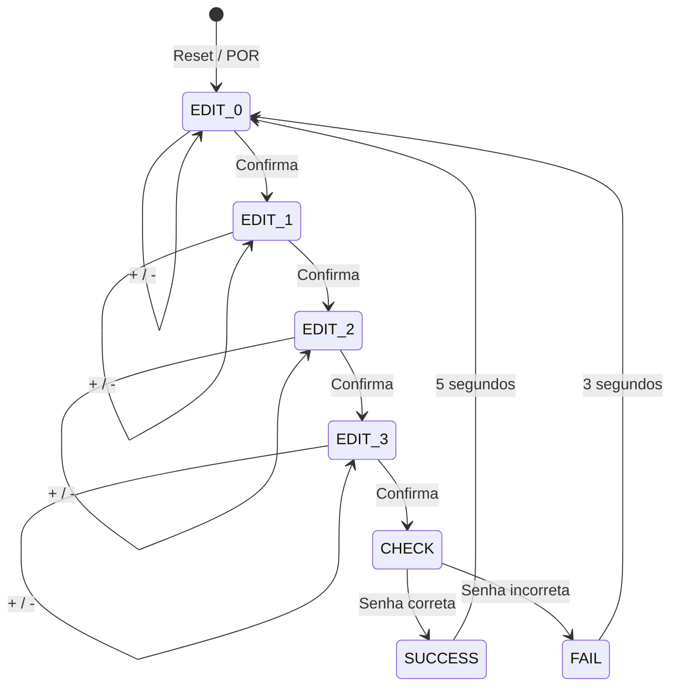

# SafeCrack Pro

**CIN0130 – Sistemas Digitais**  
**Professor:** Victor Medeiros  
**Semestre:** 2026.1  

**Placa:** Terasic DE2-115  
**FPGA:** Intel/Altera Cyclone IV E – **EP4CE115F29C7**  
**Ferramenta:** Quartus Prime **21.1**

Cofre digital com seleção de dígitos por push-buttons e displays de 7 segmentos.

---

## 1. Início Rápido – Como abrir e programar

### Passo 1 – Extrair
Extraia o ZIP em qualquer pasta (exemplo: `Desktop\SafeCrackPro`).

### Passo 2 – Abrir no Quartus Prime 21.1
1. Abra o **Quartus Prime 21.1**
2. **File → Open Project…**
3. Navegue até a pasta `SafeCrackPro/quartus/`
4. Selecione o arquivo:

```
SafeCrackPro.qpf          ← ABRA ESTE ARQUIVO
```

### Passo 3 – Verificar o dispositivo
- Assignments → Device…
- Confirme:
  - **Family:** Cyclone IV E  
  - **Device:** EP4CE115F29C7

### Passo 4 – Compilar
- Processing → **Start Compilation** (ou botão ▶)
- Aguarde até aparecer *Full Compilation was successful*

### Passo 5 – Programar a placa
1. Conecte a DE2-115 via USB-Blaster e ligue a alimentação
2. Tools → **Programmer**
3. Hardware Setup → selecione **USB-Blaster**
4. Add File → selecione:

```
SafeCrackPro/quartus/output_files/SafeCrackPro.sof
```

5. Marque a coluna **Program/Configure**
6. Clique em **Start**

### Passo 6 – Testar
| Botão   | Função                          |
|---------|---------------------------------|
| KEY[3]  | Decrementa o dígito ativo       |
| KEY[2]  | Incrementa o dígito ativo       |
| KEY[1]  | Confirma e avança               |
| KEY[0]  | Reset completo                  |

- **Senha padrão:** `1234`
- HEX4 mostra o índice do dígito em edição (0 a 3)
- Senha correta → todos os **LEDs verdes** por 5 segundos
- Senha incorreta → todos os **LEDs vermelhos** por 3 segundos

---

## 2. Conteúdo do Repositório

```
SafeCrackPro/
├── quartus/
│   ├── SafeCrackPro.qpf      ← Arquivo principal do projeto
│   ├── SafeCrackPro.qsf      ← Configurações + pinagem
│   └── SafeCrackPro.sdc      ← Constraints de timing
│
├── rtl/                      ← Código SystemVerilog (sintetizável)
│   ├── safecrack_pro_top.sv  ← Top-level
│   ├── safecrack_fsm.sv      ← Máquina de estados
│   ├── debounce.sv           ← Debounce + detecção de borda
│   └── bcd_to_7segment.sv    ← Decodificador de 7 segmentos
│
├── sim/
│   └── tb_safecrack_pro.sv   ← Testbench de validação
│
├── docs/                     ← Documentação técnica completa
│   ├── 01-overview/
│   ├── 02-architecture/
│   ├── 04-modules/
│   ├── 05-hardware/
│   ├── 06-fsm/
│   ├── 09-testing/
│   ├── 10-evolution/
│   ├── 11-incidents/
│   └── 12-maintenance/
│
├── README.md                 ← Este arquivo
└── LICENSE
```

---

## 3. Arquitetura em 30 segundos



| Bloco | Função |
|-------|--------|
| `debounce` | Sincroniza, elimina bounce e gera 1 pulso por clique |
| `safecrack_fsm` | Controla edição dos dígitos, verificação e feedback |
| `bcd_to_7segment` | Converte 0–9 para o padrão real dos displays da DE2-115 |

Documentação completa da arquitetura: [docs/02-architecture/](docs/02-architecture/architecture-overview.md)

---

## 4. Máquina de Estados



Documentação detalhada da FSM: [docs/06-fsm/state-machine.md](docs/06-fsm/state-machine.md)

---

## 5. Senha configurável

Arquivo: `rtl/safecrack_pro_top.sv`

```systemverilog
parameter logic [3:0] PASSWORD_D0 = 4'd1; // HEX3 (mais significativo)
parameter logic [3:0] PASSWORD_D1 = 4'd2; // HEX2
parameter logic [3:0] PASSWORD_D2 = 4'd3; // HEX1
parameter logic [3:0] PASSWORD_D3 = 4'd4; // HEX0 (menos significativo)
```

Altere os valores, salve e recompile.

---

## 6. Pinagem resumida

| Sinal     | Pino     | Função                    |
|-----------|----------|---------------------------|
| CLOCK_50  | PIN_Y2   | Clock 50 MHz              |
| KEY[0]    | PIN_M23  | Reset                     |
| KEY[1]    | PIN_M21  | Confirmação               |
| KEY[2]    | PIN_N21  | Incremento                 |
| KEY[3]    | PIN_R24  | Decremento                |
| HEX0–HEX4 | (vários) | Displays de 7 segmentos   |
| LEDG[8:0] | (vários) | LEDs verdes (sucesso)     |
| LEDR[17:0]| (vários) | LEDs vermelhos (falha)    |

Pinagem completa: [docs/05-hardware/pinout.md](docs/05-hardware/pinout.md)

---

## 7. Documentação Técnica

Toda a documentação profissional está organizada em:

**[docs/README.md](docs/README.md)**

| Seção | O que você encontra |
|-------|---------------------|
| [01 – Overview](docs/01-overview/) | Objetivos e requisitos rastreáveis |
| [02 – Architecture](docs/02-architecture/) | Arquitetura e decisões de projeto |
| [04 – Modules](docs/04-modules/) | Documentação de cada módulo RTL |
| [05 – Hardware](docs/05-hardware/) | Interface completa com a DE2-115 |
| [06 – FSM](docs/06-fsm/) | Estados, transições e regras |
| [09 – Testing](docs/09-testing/) | Estratégia de simulação |
| [10 – Evolution](docs/10-evolution/) | Histórico e decisões técnicas |
| [11 – Incidents](docs/11-incidents/) | Registro de bugs e correções |
| [12 – Maintenance](docs/12-maintenance/) | Known issues |

---

## 8. Critérios de Avaliação – Como o projeto atende

| Critério | Peso | Evidência no projeto |
|----------|------|----------------------|
| Funcionamento correto da FSM | 25% | Estados e transições claros + documentação em `docs/06-fsm/` |
| Interação com hardware | 20% | Debounce profissional, displays oficiais, pinagem completa |
| Qualidade do código | 15% | Modularização, SystemVerilog moderno, comentários |
| Simulação e validação | 10% | Testbench com 10 cenários documentados |
| Documentação | 10% | Documentação técnica completa sob `docs/` |

---

## 9. Known Issues

| Item | Observação |
|------|------------|
| Arquivo `.sof` | Não vem pré-gerado. É criado automaticamente na primeira compilação. |
| Debounce | Configurado para ≈ 5 ms (adequado aos botões da DE2-115). |
| Bug do decoder | Já corrigido (ver [INC-001](docs/11-incidents/INC-001-7segment-decoder.md)). |

Lista completa: [docs/12-maintenance/known-issues.md](docs/12-maintenance/known-issues.md)

---

**Projeto pronto para uso.**  
Abra o `SafeCrackPro.qpf`, compile e programe a placa.
