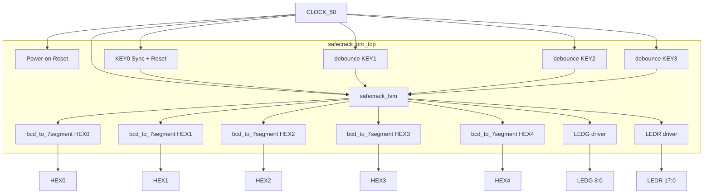

# Arquitetura do Sistema

## Visão Geral

SafeCrack Pro é um sistema digital síncrono implementado em SystemVerilog para a FPGA Cyclone IV E da placa DE2-115. A arquitetura segue o clássico padrão de **FSM + Datapath**, com separação clara entre controle e caminho de dados.

## Camadas

| Camada | Componentes | Responsabilidade |
|--------|-------------|------------------|
| Interface de entrada | `debounce` × 3 + lógica de KEY[0] | Sincronização, debounce e geração de pulsos limpos |
| Controle | `safecrack_fsm` | Máquina de estados, sequência de edição, verificação e feedback |
| Datapath | Registradores de dígitos + contador de timer | Armazenamento da senha e temporização |
| Interface de saída | `bcd_to_7segment` × 5 + drivers de LED | Conversão e acionamento de displays e LEDs |

## Princípios de projeto

1. **Síncrono**: todo o sistema opera no domínio do CLOCK_50.
2. **Reset assíncrono de asserção / síncrono de desasserção**: padrão seguro para FPGAs.
3. **Um pulso por evento**: garante que manter o botão pressionado não gere múltiplas ações.
4. **Parâmetros configuráveis**: senha e tempos de feedback podem ser alterados sem modificar a lógica.
5. **Modularidade**: cada módulo possui responsabilidade única e interface bem definida.

## Decisões arquiteturais relevantes

| Decisão | Justificativa |
|---------|---------------|
| FSM com estados de edição separados (EDIT_0…3) | Facilita a compreensão e a correspondência com o dígito ativo |
| Timer implementado dentro do FSM | Evita módulos adicionais desnecessários para uma contagem simples |
| Decoders de 7 segmentos instanciados no top | Mantém o FSM independente da polaridade dos displays |
| Debounce configurável por parâmetro | Permite acelerar a simulação sem alterar o código de produção |
