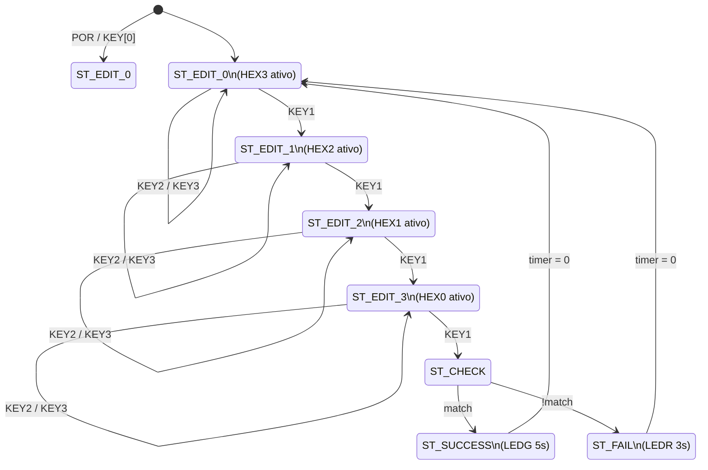

# Máquina de Estados – Documentação Detalhada

## Diagrama de estados

## Transições

| Estado atual | Evento | Próximo estado | Ação colateral |
|--------------|--------|----------------|----------------|
| ST_EDIT_n | key2_pulse | ST_EDIT_n | Incrementa dígito ativo (wrap) |
| ST_EDIT_n | key3_pulse | ST_EDIT_n | Decrementa dígito ativo (wrap) |
| ST_EDIT_0..2 | key1_pulse | ST_EDIT_{n+1} | Avança índice |
| ST_EDIT_3 | key1_pulse | ST_CHECK | Inicia verificação |
| ST_CHECK | match | ST_SUCCESS | Carrega timer = 5 s |
| ST_CHECK | !match | ST_FAIL | Carrega timer = 3 s |
| ST_SUCCESS | timer > 0 | ST_SUCCESS | Decrementa timer |
| ST_SUCCESS | timer = 0 | ST_EDIT_0 | Zera dígitos e índice |
| ST_FAIL | timer > 0 | ST_FAIL | Decrementa timer |
| ST_FAIL | timer = 0 | ST_EDIT_0 | Zera dígitos e índice |
| qualquer | KEY[0] | ST_EDIT_0 | Reset completo |

## Convenção do dígito ativo

O sinal interno `active_idx` usa 0–3. O valor exibido em **HEX4** é `active_idx + 1` (ou seja, 1–4), conforme orientação do monitor.

| active_idx (interno) | Valor em HEX4 | Display editado | Posição na senha |
|----------------------|---------------|-----------------|------------------|
| 0 | **1** | HEX3 | 1º dígito (MSB) |
| 1 | **2** | HEX2 | 2º dígito |
| 2 | **3** | HEX1 | 3º dígito |
| 3 | **4** | HEX0 | 4º dígito (LSB) |
